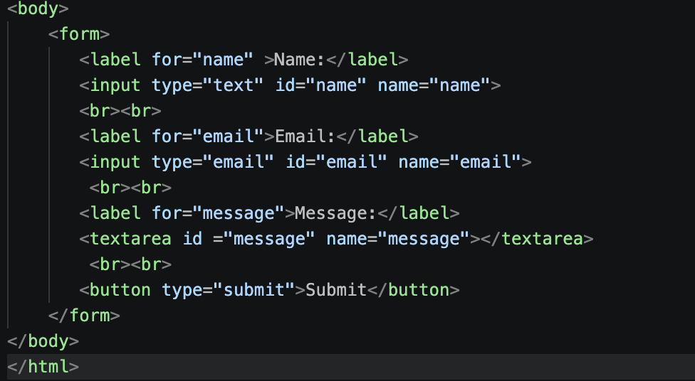
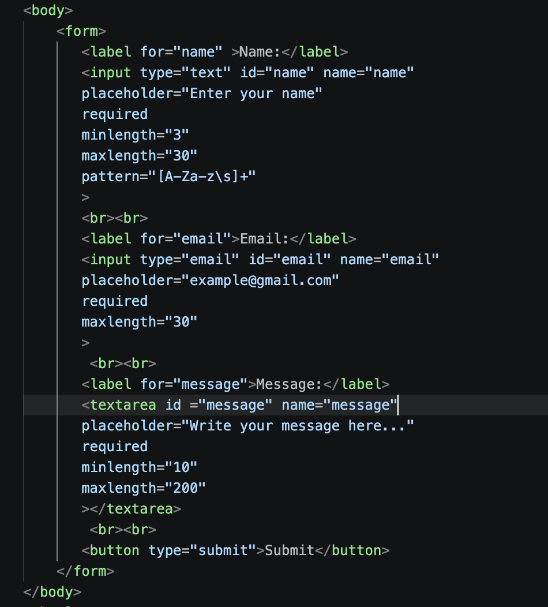
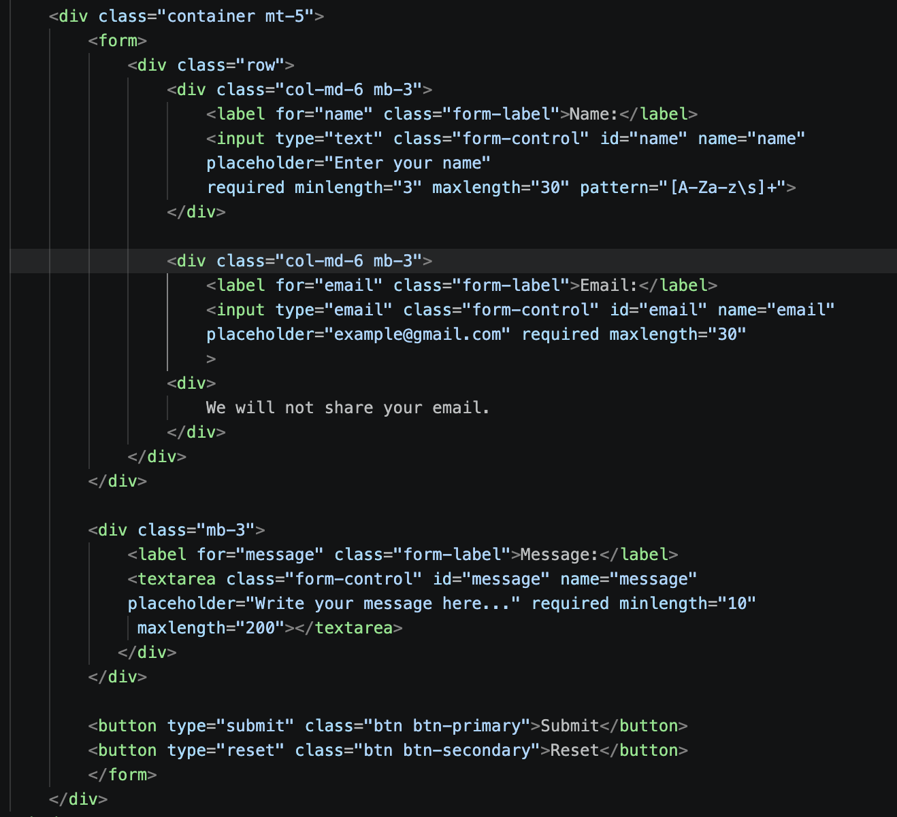
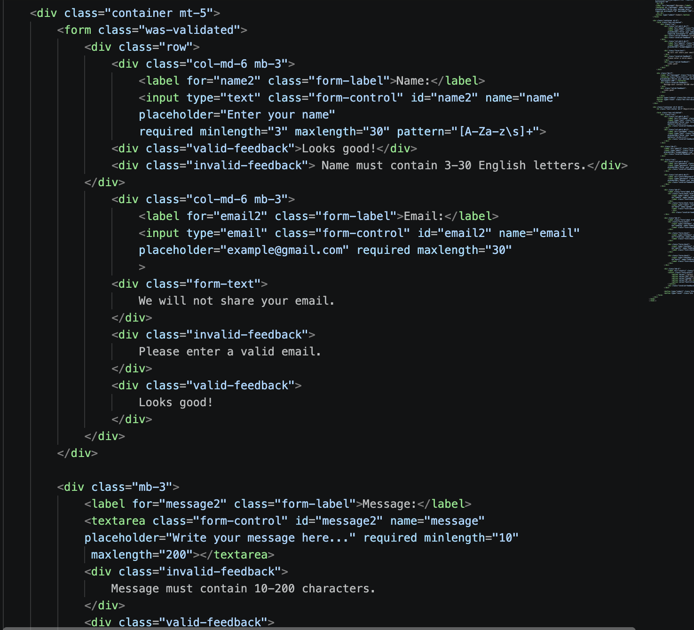
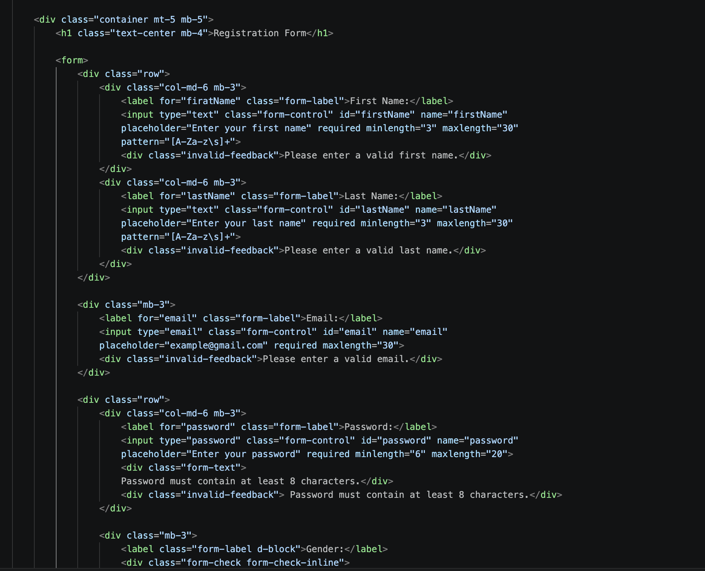
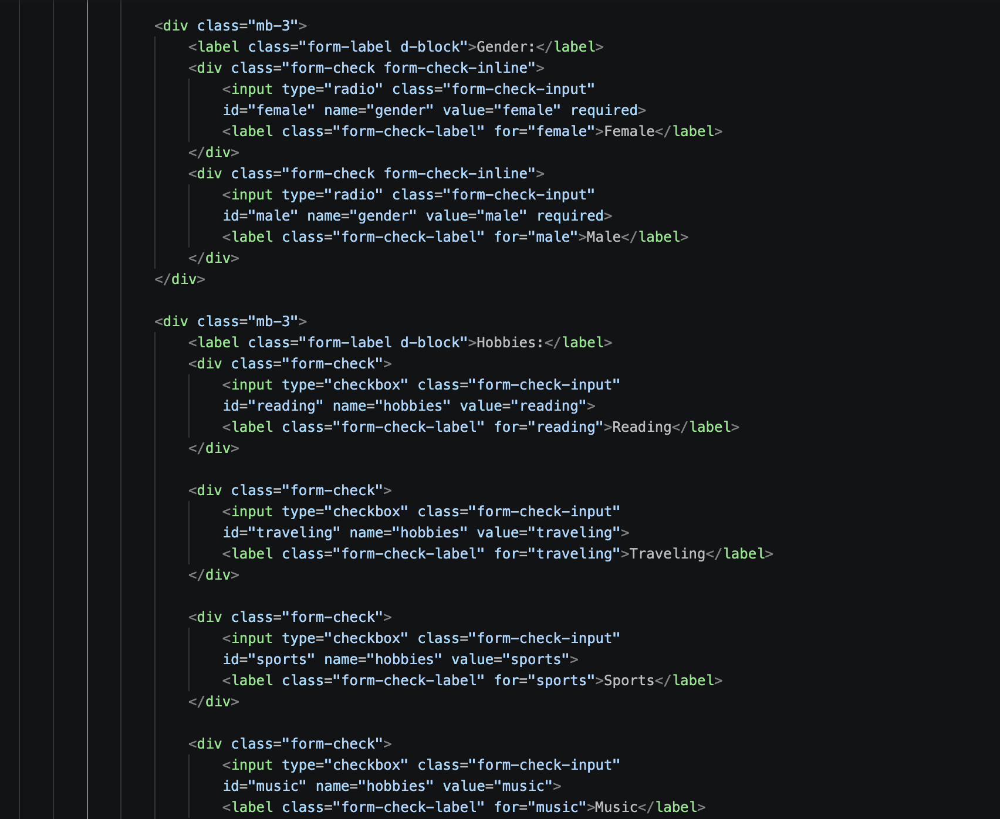
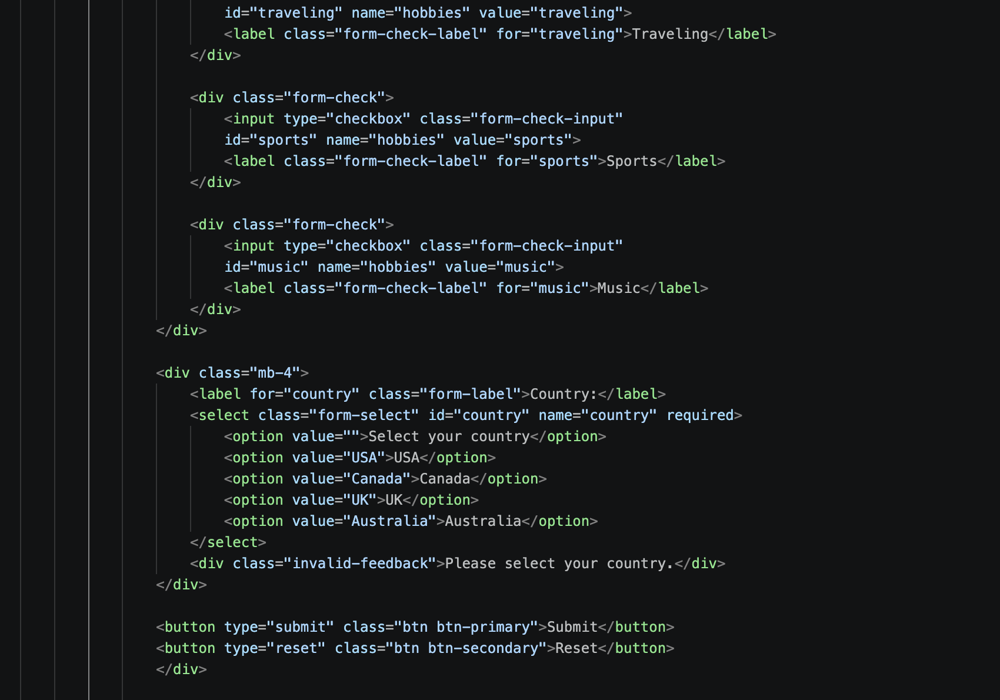

Part 1. Basic HTML Forms

Task 0. Simple Contact Form
•	Create a basic contact form with the following fields:
	Name (text input)
	Email (email input)
	Message (textarea)
	Submit button
•	Ensure all fields have proper <label> elements.

Task 1. Form with HTML5 Validation
•	Add built-in validation attributes (required, type, ma5xlength, etc.).
•	Test how the browser enforces validation (e.g., email format, empty fields).

Part 2. Bootstrap Forms

Task 2. Bootstrap Form Styling
•	Recreate the contact form using Bootstrap form classes.
•	Use Bootstrap’s grid system to arrange form fields neatly.
•	Add placeholders and helper text where appropriate.

Task 3. Bootstrap Validation Styles
•	Apply Bootstrap’s validation feedback classes (is-valid, is-invalid).
•	Show feedback messages below inputs (e.g., “Email is required”, “Looks good!”).
•	Test the form by entering valid and invalid data.

Part 3. Advanced Form Project

Task 4. Registration Form
•	Create a registration form for a website. It should include:
	First Name, Last Name
	Email
	Password + Confirm Password
	Gender (radio buttons)
	Hobbies (checkboxes)
	Country (select dropdown)
	Submit and Reset buttons
•	Style the form with Bootstrap Grid so it is responsive.
•	Add HTML5 validation (e.g., password must have minimum length).
•	Add Bootstrap validation feedback to display error/success messages.

During this assignment, I learned how to create HTML forms using input fields, labels, textareas, and buttons. I practiced using HTML5 validation attributes such as `required`, `minlength`, `maxlength`, and `type="email"`. I also learned how to style forms with Bootstrap classes like `form-control`, `form-label`, and `form-select`. I practiced using the Bootstrap grid system to arrange form fields and make the registration form responsive. In addition, I learned how to use radio buttons, checkboxes, and dropdown menus. I also worked with Bootstrap validation classes such as `is-valid` and `is-invalid` to display feedback messages. This assignment helped me understand how to build and validate HTML forms using Bootstrap.